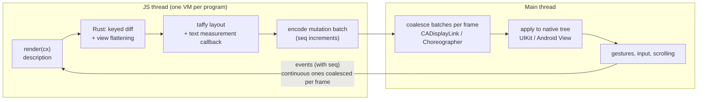

# Architecture

native-shell runs small JavaScript programs ("mini programs") inside an iOS or
Android app and renders them with the platform's own views: UIKit on iOS,
Android `View`s on Android. Its programming model is gpui-shell's: a program
`export default`s a `View` subclass whose `render(cx)` describes the UI with
builder calls (`v_flex().p_4().gap_2().child(…)`), and invalidates itself with
`cx.notify()`.

## Summary of decisions

1. **Feasible, and isomorphic to React Native's Fabric renderer**: the JS
   thread produces a description, Rust diffs it by key and lays it out with
   taffy, a binary mutation batch goes to the main thread, which applies it to
   native views. The hard parts are not the widget count but three things:
   **text measurement that matches rendering**, **controlled inputs that do
   not break IME composition**, and **long-list virtualization**.
2. **Not React Native, and not Fabric without React.** RN offers no official
   isolation between several programs in one app, Hermes bytecode is tied to
   the host's RN version, the binary is large, and its API differs from
   gpui-shell's. Driving `nativeFabricUIManager` directly uses a private host
   config with the same size and build cost. Instead, native-shell has its own
   small core and **ports specific RN algorithms** (listed below).
3. **Choices**: QuickJS (the `quickjs-jit` fork, **JIT disabled**: interpreter
   only, no cranelift linked; iOS forbids mapping executable memory), taffy for
   layout, UIKit on iOS, Android `View` on Android (a custom `ViewGroup`
   placing children at taffy frames; `TextView`, `EditText`, `RecyclerView`
   for the controls), Compose hosts embed it through `AndroidView`. Control
   plane over a C ABI (and JNI); the hot path is one call per batch with a
   zero-copy buffer. A custom binary instruction stream with string and value
   tables.
4. **Android View rather than Compose**: the UI is described in JS and laid
   out in Rust, so what Compose is good at (hand-written declarative UI) does
   not apply, while its costs would: a mirrored snapshot tree, measurement that
   cannot be handed to rendering, and a Compose dependency for every host.
   `View` mirrors UIKit (imperative retained tree), and `PrecomputedText` lets
   a measurement made off the main thread be handed to `TextView` as is, which
   removes the first risk.
5. **App Store**: guideline 4.7 no longer requires WebKit/JavaScriptCore. The
   main risk is **4.7.2**: exposing native platform APIs to third-party
   programs needs Apple's prior permission. First-party JS is unaffected. Host
   extensions are therefore **host-defined, mediated services** gated per
   program, never raw platform APIs.

## Pipeline



1. **JS, diff and layout run on the JS thread**; the main thread only applies
   batches. iOS applies a batch inside one `CATransaction`; Android applies a
   whole batch within one main-thread message. No frame ever shows half a
   batch.
2. **Threading is configurable**: tiny programs can run entirely on the main
   thread (no hop, no blank first frame). The first frame can be rendered
   synchronously.
3. **Platform callbacks that need a synchronous answer never wait for JS**:
   `shouldChangeCharactersIn`, context-menu configuration, the Android back
   callback's `isEnabled`, `InputFilter`, accessibility action results… are
   answered from properties declared in the description (`max_length`,
   `allowed_chars`, `can_go_back`, prebuilt menus).
4. **State owned natively does not round-trip through rendering** (RN's C++
   State idea): scroll offsets and input text live in the native view; JS gets
   events.
5. **Continuous gestures and animations run natively**: following a drag or
   pinch is done with transforms; JS receives throttled and final events.
   Animations are declarative (`transition`, `spring`).

## Crates and platform packages

```text
crates/core      contracts: protocol, styles, theme, descriptions, host interfaces, manifest
crates/tree      keyed diff, flattening, taffy layout, measurement cache, list windowing
crates/services  storage, fs, fetch, WebSocket, crypto, signed bundles, bytecode
crates/engine    `native-shell`: QuickJS instance, sandbox, JS prelude, scheduler, events, runner
crates/ffi       C ABI (iOS) + JNI (Android); xcframework / .so
crates/cli       new, check, types, bundle, keygen, verify, dev
platforms/ios/   Swift Package + podspec: UIKit renderer, TextKit measurement, host registration
platforms/android/ Gradle: AAR (View renderer, PrecomputedText measurement), compose wrapper, example
examples/        example programs
```

## The mutation protocol

Specified in `crates/core/src/protocol.rs` (framing, ops, view types,
properties, events, commands) and `docs/protocol-json.md` (JSON-valued
properties and payloads).

* Header word per instruction: `opcode:8 | node:24`, extended to a full 32-bit
  id when needed; little endian, 4-byte aligned.
* Instructions: `Create(type)`, `Insert(parent, index)`, `Remove`,
  `Delete(subtree)`, `Move`, `SetProp(prop, kind, value)`,
  `SetFrame(x, y, w, h)`, `SetEventMask(bits)`, `Command`,
  `BeginBatch(seq, flags)` / `EndBatch`.
* Values: integers, floats and colors inline; strings, JSON documents and
  float arrays by index into tables at the end of the buffer. Strings are
  UTF-8 bytes (never JNI modified UTF-8).
* `seq`: events carry the batch seq the renderer had applied, so an event
  aimed at a node that has since been replaced is dropped. Node ids are never
  reused.
* The instruction set is closed and versioned, and part of the ABI hash that
  signed bundles declare.
* Reset contract: a property sent as `Null` returns to its default. This is
  what makes view pooling safe.

## Ported React Native algorithms

| # | What | RN source | Where |
| --- | --- | --- | --- |
| 1 | Controlled-input event-count protocol: each native edit increments a counter; JS writes carry the count they saw and stale ones are dropped; programmatic writes don't echo; equal text is not rewritten; nothing is written during composition | `RCTTextInputComponentView.mm`, `ReactEditText.kt`, `ReactTextInputTextWatcher.kt` | protocol + Swift / Kotlin |
| 2 | Text measurement: TextKit stack configuration, fixed line height with baseline centering, pixel rounding, empty-string shortcut, per-thread paint, layout reuse | `RCTTextLayoutManager.mm`, `TextLayoutManager.kt` | native measurement callbacks |
| 3 | Mutation ordering and view flattening (layout-only nodes get no native view) | `Differentiator.cpp` | `crates/tree` |
| 4 | Press feedback timing (long press 500 ms, hit slop) | `Pressability.js` | native |
| 5 | Event priority: continuous events coalesced per frame, discrete ones delivered immediately | `EventBeat`, EventQueue | `crates/engine` |
| 6 | Accessibility role/state/action mapping | `ReactAccessibilityDelegate.kt` | Swift / Kotlin |
| 7 | List semantics: visible range callbacks, prefetch window | `virtualized-lists` | native lists + `crates/tree` |

## Text

Measurement and rendering must use the same engine and configuration.

* **iOS**: a private TextKit 1 stack per measuring thread
  (`NSTextStorage` / `NSLayoutManager` / `NSTextContainer`), padding and insets
  zero, fixed line height with baseline centering, results ceiled to device
  pixels, empty strings short-circuited, first baseline reported. Non-selectable
  text is drawn with the same TextKit 1 configuration; selectable text uses
  `UITextView(usingTextLayoutManager: false)` so it is TextKit 1 too (mixing a
  TextKit 1 measurement with TextKit 2 rendering produces sub-pixel wrapping
  differences).
* **Android**: `PrecomputedText` (API 28+, `StaticLayout` below) on the JS
  thread; the very same object is handed to `TextView.setText`, or the same
  `StaticLayout` is drawn directly for non-selectable text. One `TextPaint`
  per thread, `includeFontPadding = false`, `LineHeightSpan` for line height.
* The core sends the exact `AttributedText` JSON it measured, so renderers can
  cache the measured layout under that string and draw it without measuring
  again.
* Verification: a golden matrix of fonts × CJK × emoji × line heights × font
  scale (1.0 / 1.3 / 2.0); error ≤ 1 px.
* Text size (Dynamic Type, Android font scale) is split in two, as in GPUI
  where the rem is the zoom axis. Text scales fully, inside the renderer's
  measurer and drawing; the core keeps text sizes unscaled. Layout lengths
  given in rems scale with the effective rem, `16 × clamp(font_scale, 1.0,
  1.6)` (`style::rem_size`, `MAX_LAYOUT_SCALE`): the style resolver records
  which lengths were rems (`Resolved::rems`) and the tree lays them out at the
  current rem, so a font scale change re-lays out without re-resolving styles.

## Inputs (IME)

* The native view owns the text; diffing never recreates an input node; pooled
  inputs are reset (text, selection, listeners).
* Scripts get `change(text, selection, composing)`; writes from scripts carry
  the event count, and renderers apply them only when not stale and not while
  composing (iOS `markedTextRange != nil`, Android composing span present).
* Filters (max length, allowed characters) are declared and enforced natively.
* Selection offsets are UTF-16 at the boundary.

## Long lists

* Each row is its own taffy root laid out at the list's width; rows never
  rendered use an estimated height, refined once rendered.
* The renderer reports the visible range plus a prefetch window; scripts render
  only that window, each row an independent subtree.
* Native recycling (`UICollectionView`, `RecyclerView`) keeps scrolling smooth;
  placeholders cover rows not yet rendered.

## Mini program container

* **One VM per program**, not per page. Each runtime has a memory limit, a
  stack limit and an interrupt handler enforcing per-call time budgets.
* **Crash isolation**: programs share the app process; every FFI entry point
  catches panics; ids and values from JS are validated; a failure destroys only
  that instance.
* **Bundles and signatures**: a manifest lists every file's hash, signed with
  Ed25519, several keys for rotation, a revocation list, a minimum runtime
  version and the engine ABI hash. Bytecode is only ever loaded from a bundle
  whose signature verified (QuickJS's bytecode reader is not hardened against
  hostile input); otherwise sources are compiled.
* **Capabilities**: the manifest declares what a program may use (network
  hosts, storage, fs in its data directory, clipboard, URLs, host modules and
  components); everything else is denied.

## Host extension

The embedding app registers **host modules** (JS-importable modules answered
by native code: sync methods, async methods, events pushed to scripts) and
**host components** (native views placed and laid out by scripts). See
"Host integration design" in `docs/agents-plan.md`.

## Risks and mitigations

| # | Risk | Mitigation |
| --- | --- | --- |
| 1 | Text measured and rendered differently (clipped text, jumping wraps) | One engine and configuration for both; hand the measured layout to rendering; golden tests |
| 2 | Controlled inputs breaking IME composition | Native-owned text; event-count protocol; no writes during composition; declarative filters |
| 3 | Interpreter latency (gestures, scroll-linked effects, synchronous callbacks) | Native gestures and animations; declared answers to synchronous questions; synchronous first frame; configurable threading; bytecode |
| 4 | App Store 4.7.2 | Mediated host services only; per-program grants |
| 5 | Many native views (creation, memory) | Flattening, view pools, frame-only updates; 1k / 3k / 10k node benchmarks |
| 6 | Blank rows when flinging long lists | Native recycling + prefetch window + placeholders |
| 7 | iOS and Android renderers drifting apart | One protocol and Rust core; shared conformance tests |
| 8 | Maintenance burden | Small, fully owned widget set; closed, versioned protocol |
| 9 | Debugging | Remote logs and hot reload first; a CDP/DAP server for QuickJS later |
